# 🖤 𝕯𝖊𝖛 𝕾𝖍𝖎𝖙 🖤

### *"In the abyss of code, I forge digital nightmares"*

---

---

## 🚨 Tech Stories

### New EggStreme Malware Variant Goes Silent to Evade Security Tools in Government Attacks
- **Published**: November 18, 2026
- **Summary**: The suspected Chinese advanced persistent threat (APT) group behind the sophisticated EggStreme malware has rebuilt its toolkit as it continues to tar...
- [Read more](https://thehackernews.com/2026/11/eggstreme-hackers-rebuild-malware-with.html)

### New Attack Bypasses TPM Lockout to Crack Windows Hello and BitLocker PINs in Days, Not Years
- **Published**: November 18, 2026
- **Summary**: On AMD-based PCs and some Intel PCs, the TPM lockout for Windows Hello and BitLocker PINs can be reset by someone who opens the PC's case, researchers...
- [Read more](https://thehackernews.com/2026/11/flash-chip-attack-bypasses-tpm-lockout.html)

---

### 🔮 Elemental Affinities

---

---

