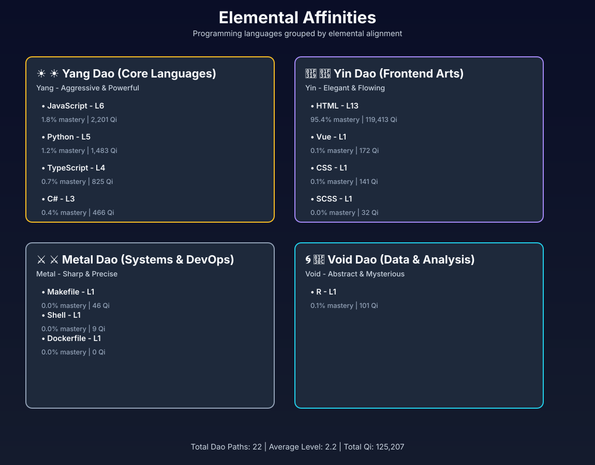
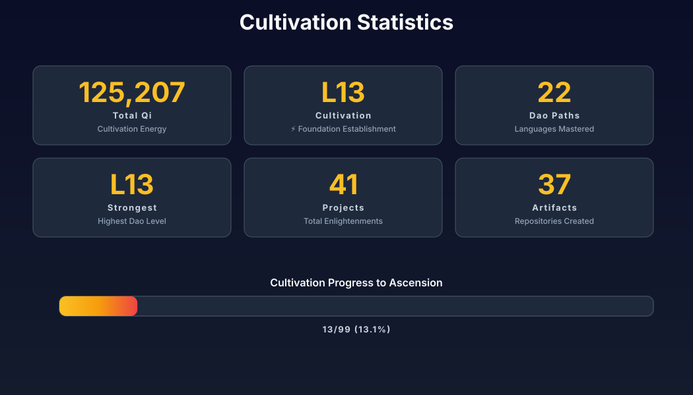

# 🖤 𝕯𝖊𝖛 𝕾𝖍𝖎𝖙 🖤

### *"In the abyss of code, I forge digital nightmares"*

---

---

## 🚨 Tech Stories

### Microsoft Patches 1,259 Flaws, Including Exploited Outlook Bug That May Expose NTLMv2 Hashes
- **Published**: November 11, 2026
- **Summary**: Microsoft on Tuesday released patches for a total of 1,259 vulnerabilities spanning its software portfolio, the second consecutive month where the pat...
- **Keywords**: bug
- [Read more](https://thehackernews.com/2026/11/microsoft-patches-1259-flaws-including.html)

### Over 35,000 Grok-Built Apps Exposed Online, Some Leaking Confidential Data and Passwords
- **Published**: November 11, 2026
- **Summary**: Of the 37,571 Grok-built apps that security company Claroc found online, 35,578 were open to anyone without a sign-in, the researchers said yesterday....
- [Read more](https://thehackernews.com/2026/11/over-35000-grok-built-apps-exposed.html)

---

### 🔮 Elemental Affinities

---

---

