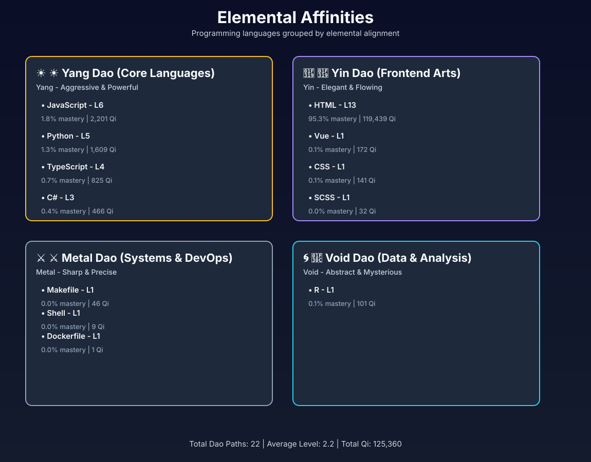

# 🖤 𝕯𝖊𝖛 𝕾𝖍𝖎𝖙 🖤

### *"In the abyss of code, I forge digital nightmares"*

---

---

## 🚨 Tech Stories

### Reddit's traffic is down 13%, partly thanks to AI Overviews
- **Published**: November 15, 2026
- **Summary**: <td> <a href="https://www.reddit.com/r/technology/comments/1xx4f37/reddits_traffic_is_down_13_partly_thanks_to_ai/"> 

Comments URL: <a href="https://news.ycombinator.com/item?id=50511485">h......
- [Read more](https://aspiz.uk/wiki/AnthropomorphicSoftware)

---

### 🔮 Elemental Affinities

---

---

