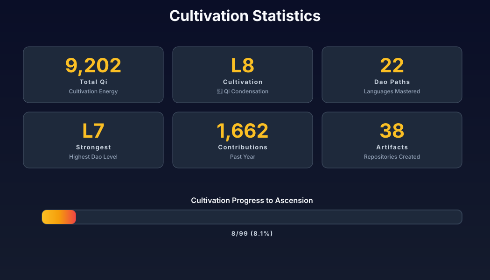

# 🖤 𝕯𝖊𝖛 𝕾𝖍𝖎𝖙 🖤

### *"In the abyss of code, I forge digital nightmares"*

---

---

## 🚨 Tech Stories

### Rustrak, a self-hosted error tracker for your existing Sentry SDKs
- **Published**: November 19, 2026
- **Summary**: https://github.com/rustrak/rustrak</a>

Comments URL: <a href="https://news.ycombinator.com/item?id=50565302">https://news.ycombinato......
- **Keywords**: error
- [Read more](https://github.com/rustrak/rustrak)

### phpAfterShell Explained: How Hackers Could Turn a PHP Session Flaw Into Code Execution
- **Published**: November 19, 2026
- **Summary**: PHP's default file-based session storage can be made to return objects an attacker chose, by cutting off a session write at the right moment. When com...
- [Read more](https://thehackernews.com/2026/11/phpaftershell-explained-how-hackers.html)

---

### 🔮 Elemental Affinities

---

---

